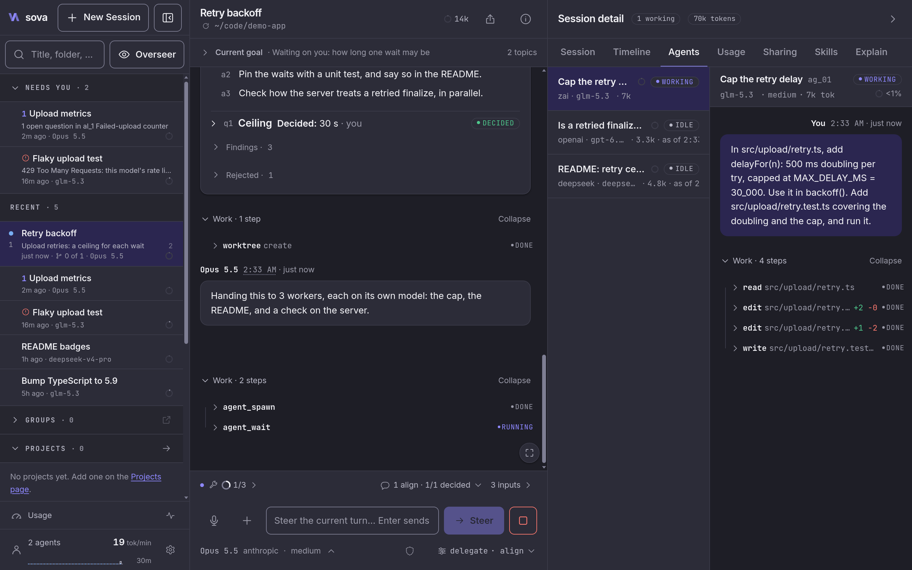
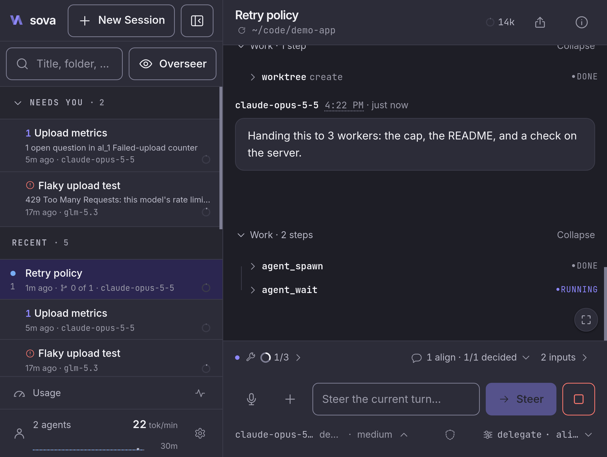
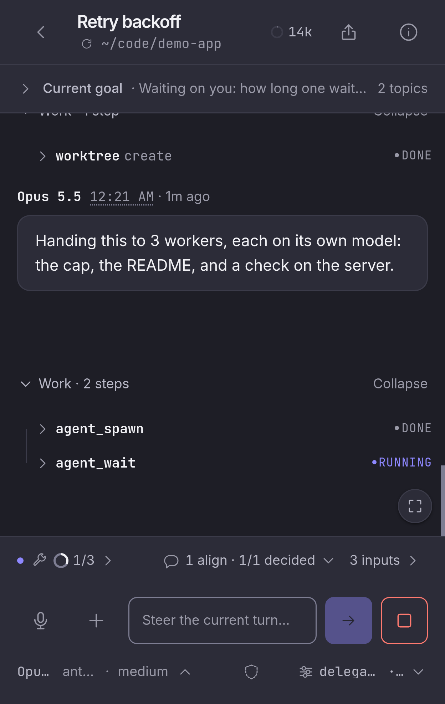
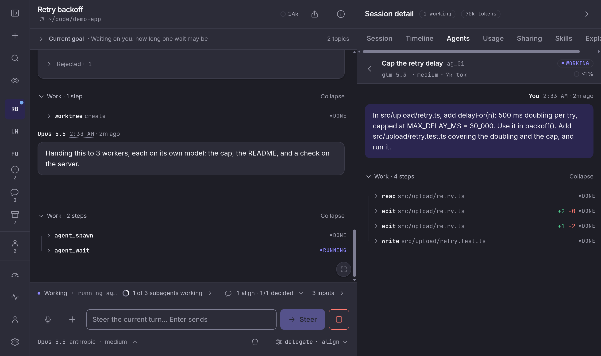
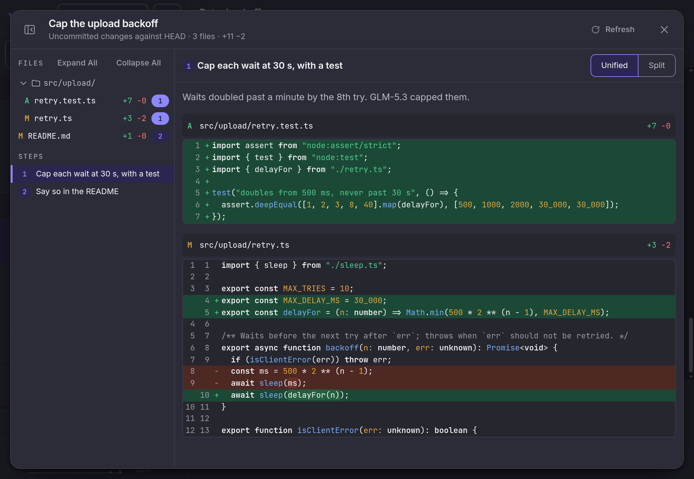

<p>
  <picture>
    <source media="(prefers-color-scheme: dark)" srcset="docs/brand/sova-mark-dark.svg">
    
  </picture>
</p>

# Sova

**Every agent session, one calm workspace. On your desk, or folded in your pocket.**

Sova runs the [pi](https://pi.dev) coding agent on your own machine, through pi's SDK, and reads
the same `~/.pi/agent` your terminal does. It lists every session on the machine, shows any
transcript, watches a session that's open in a TUI as it runs, and gives web chats workers,
branching and steering. It is one person's tool for one person's agent.

<a href="https://sova.naomarik.com/" title="Watch a session run in Sova (22-second video on the site)">
  
  
  
</a>

The same session on a desktop, an unfolded foldable and a folded phone.
[Watch it run on the site](https://sova.naomarik.com/).

## Try it

On macOS or Linux, with Git and Node.js 22.19 or later:

```sh
curl -fsSL https://raw.githubusercontent.com/Naomarik/sova/stable/scripts/install.sh | bash
```

That builds the latest release (the `stable` tag) in `~/.local/share/sova` and adds **Sova** to
your app launcher. Open it from there, or run `sova open`: it starts the server and opens
`http://127.0.0.1:4800` already unlocked. It uses your existing pi provider login.
[Requirements and first login](docs/getting-started.md).

## Why you'd run it

- **Every session in one place.** Web chats and the sessions pi wrote in your terminal, with no
  import. A session open in a TUI streams live and is read-only here; Sova identifies it reliably
  only when your terminal pi loads the [sessions extension](pi-config/extensions/sessions/README.md).
- **Hand work to subagents and follow each one.** In [Delegate mode](https://sova.naomarik.com/docs/modes/delegate/)
  the agent sends planning, investigation and changes to workers, each with its own transcript and
  context gauge in the workers pane. The shipped routes use Claude Code models, so install the
  `claude` CLI or [pick your own](https://sova.naomarik.com/docs/subagent-profiles/).
- **Agree on the approach before it's built.** With [align](https://sova.naomarik.com/docs/modes/align/)
  on, the agent records its findings, approach, rejected alternatives and open questions, and waits
  for your answers. It is a mode you turn on, not the default.
- **Read every change as steps.** The [changes viewer](https://sova.naomarik.com/docs/worktrees-and-changes/)
  shows what a session or worktree changed as numbered steps, each with the agent's reason when it
  gave one. It is read-only: you review there and edit elsewhere.
- **Know which session needs you, on your phone too.** The [Needs you](https://sova.naomarik.com/docs/needs-you/)
  list shows the sessions waiting on you, and can reach your phone as a push. The phone needs a
  [protected route](https://sova.naomarik.com/docs/phone/) to this machine, such as a tunnel or an
  HTTPS proxy, and a pairing code.





**Also in Sova:** [rewind, fork and steer](https://sova.naomarik.com/docs/change-direction/) ·
[several Claude logins](pi-config/extensions/claude-code/README.md) with failover ·
a [sandbox per session](pi-config/extensions/sandbox/README.md) (bubblewrap or Seatbelt) ·
[18 themes and your own](docs/customization.md#themes-and-type) ·
local voice input (Settings → Voice, downloads its model) ·
read-only [share links](docs/public-links.md) on an address you set up ·
[playbooks and schedules](https://sova.naomarik.com/docs/playbooks-and-schedules/) ·
[tours](https://sova.naomarik.com/docs/modes/vis/) of a real interface ·
a usage page (tokens and costs per session) ·
the [Overseer](https://sova.naomarik.com/docs/overseer/), which asks before it acts on a risky request.

## What it isn't

Sova is for one local user. There are no accounts: one per-install token unlocks everything, and
anyone who has it can do what you can. It listens on loopback by default; protect it before you
expose it beyond this machine ([how](docs/getting-started.md#connect-from-another-device)). It is
not a hosted service. Model requests go to your configured provider, and tools and extensions may
also use the network.

## More

[Site and docs](https://sova.naomarik.com/docs/) ·
[Customize](docs/customization.md) ·
[Run as a service](docs/running-as-a-service.md) ·
[Contributing](CONTRIBUTING.md) ·
[Changelog](CHANGELOG.md)

Preview: the [mesh](https://sova.naomarik.com/mesh/) drives sessions on every Sova host on your
tailnet from one page, and [Organizations](https://sova.naomarik.com/orgs/) bring in the people you
work with through their own links.

## License

[Apache-2.0](LICENSE) · [NOTICE](NOTICE). Bundled fonts carry their own licenses in
[public/fonts/](public/fonts/); [pi-config](pi-config/LICENSE), a directory in this repo, is
licensed separately.
